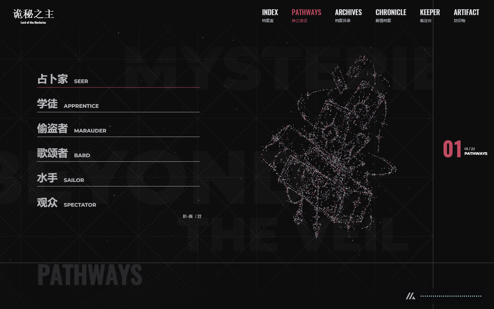
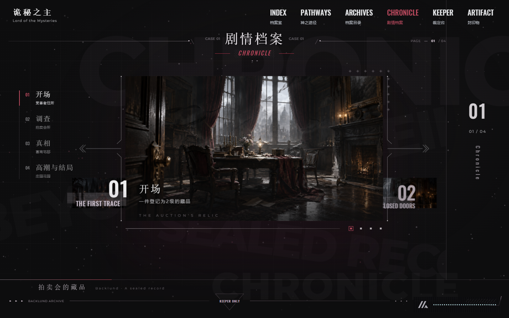

# 诡秘之主 · KP 主持台

面向《诡秘之主》同人跑团的免费 KP（守秘人）工具。以 CoC 7e d100 检定为基础，加入序列、灵感、呓语与失控机制，附四幕单次团模组《拍卖会的藏品》。

**仅面向 KP，包含完整剧情与线索剧透。** 本项目为非官方同人作品。

## 下载与启动

1. 在本仓库的 **Releases** 中下载完整使用包（发布后可用）；也可以点击 **Code → Download ZIP** 下载仓库。
2. **先完整解压**，不要直接在压缩包里打开网页。
3. 双击解压文件夹里的 **index.html**，建议使用电脑上的 Edge 或 Chrome。
4. 首页先点击物件查看分类，再次点击或点击查看详情进入页面。

不需要安装 Node.js、Python、GitHub Desktop 或其他开发工具。核心页面与素材都在本地，运行不需要网络；外部资料链接需要联网。请保留原有目录结构，不要单独移动 index.html。

## 可以做什么

| 入口 | 内容 |
| --- | --- |
| 档案室 | 物件导航首页 |
| 神之途径 | 22 条途径的粒子展示、序列与能力速查 |
| 档案目录 | 19 本规则模板、人物、异物与剧情档案 |
| 剧情档案 | 四幕剧情、调查线索、房间地图与 NPC 反应 |
| 裁定台 | d100 与常见骰子、混合表达式、呓语及失控表 |
| 封印物 | 原创封印物“拜祭之指”档案与互动展示 |

另含序列 6 安魂师只读角色模板，以及保留的旧版 KP 工具页面。

## 页面预览

## 使用提示

- 适合电脑大屏与鼠标操作，手机端尚未做完整适配验证。
- 右下角开关手动开启背景音乐；关闭后再次开启从头播放，播放中站内切页保持连续。
- 首次进入有启动动画；系统“减少动态效果”设置可简化多处动画。
- 角色卡为只读模板，资源、SAN、灵感与角色变化由 KP 另行记录。
- 掷骰记录仅用于当前会话的最近记录，不作为长期存档；关闭页面前请另行保存重要结果。
- 本团按约 3～4 人、序列 5 为主的新手中等难度设计，实际时长和难度受调查节奏影响，建议 KP 提前通读并试跑。

## 规则说明与当前范围

本项目的灵感成长、能力消耗、距离、伤害及平衡数值属于同人改编规则，不等同于小说原著数值或 CoC 官方扩展。部分能力概述仍待逐条核对；序列 0 尚未补齐完整权柄裁定。请结合桌上情况由 KP 裁定。

- [灵感与成长](docs/rules/spirituality.md)
- [序列能力的 CoC 改编](docs/rules/sequence-abilities-coc.md)
- [专属面板加成](docs/rules/panel-bonuses.md)
- [角色模板](docs/rules/character-template.md)

## 源码结构

纯静态 HTML、CSS 与原生 JavaScript，没有构建步骤或外部运行时依赖。

- 根目录 HTML：各页面及常驻音乐外层 player.html。
- css/、js/：界面样式、交互和检定逻辑。
- data/：剧情、规则、书目与离线粒子数据。
- assets/：本地图片、音频、字体、图标及许可证。
- docs/rules/：本项目改编规则说明。
- tests/：本发布版随附的七份数据与逻辑检查，可选运行 node --test tests/*.test.cjs；普通使用者无需运行。

## 许可与致谢

原创软件代码采用 [MIT License](LICENSE)，署名 wait42382-ctrl。图片、音乐、字体、图标、世界观及第三方材料不因代码开源而变更授权；详情见 [素材与许可说明](THIRD_PARTY_NOTICES.md)。不要将整个资源包视为可任意商用的 MIT 素材库。

Based on Somniomancer V1.1 by FanYUJIU. [原项目](https://github.com/FanYUJ1U/Somniomancer)；相关视觉方法的原署名与非商业许可随包保留。

项目由 AI 辅助开发与整理。欢迎 KP 试用、报告问题和提出改进建议。

## 反馈问题

请通过 [GitHub Issues](https://github.com/wait42382-ctrl/lord-of-mysteries-kp/issues) 提交：浏览器与系统、所在页面、操作步骤、预期与实际结果；必要时附截图。提交前请去掉自己的私人信息。
